<h1 align="center">
  
</h1>

<h3 align="center">
  
</h3>

---

## 🙋 About Me

I'm a second-year **B.Tech Computer Science Engineering** student who likes turning ideas into working code. I'm especially interested in **Machine Learning, Deep Learning and backend development**, and I spend my free time solving problems on LeetCode and Codeforces.

- 🎓 Currently in my **2nd year of B.Tech CSE**
- 🧠 Learning **ML / DL** and **backend engineering**
- 🛠️ Built a project with **Flask**, and work with **NumPy, Pandas, Matplotlib and Seaborn** for data analysis
- 🏆 Practising DSA and competitive programming in **C++**
- 🤝 Open to collaborating on **ML projects, backend APIs and data tools**

---

<h2 align="center">⚒️ Tech Stack ⚒️</h2>

<b>Languages</b>

  

<b>Backend &amp; Tools</b>

  

<b>Data Science &amp; ML</b>

  &nbsp;
  &nbsp;
  &nbsp;
  

  

---

<h2 align="center">🌸 Sakura Ninja 🌸</h2>

  

---

<h2 align="center">🌐 Connect With Me 🌐</h2>

  
  
  <!-- TODO: uncomment and put your profile URL here (linkedin.com/in/your-id)
  
  -->
  <!-- TODO: replace with a Discord invite link (https://discord.gg/...) or your profile link -->
  

<h3 align="center">
  
</h3>
